<!-- Hi There 波浪头图 -->

<picture><source media="(prefers-color-scheme: dark)" srcset="https://raw.githubusercontent.com/Chaosnap/Chaosnap/main/profile/header-dark.svg" /></picture>

<!-- img -->


<!-- Tech Otaku Dynamic Typing ♡ -->

  

<!-- profile logo 个人资料徽标 -->

  
  
  
  
  
  
  

<!-- visitor statistics logo 访客数统计徽标 -->

  
  
  

<picture><source media="(prefers-color-scheme: dark)" srcset="https://raw.githubusercontent.com/Chaosnap/Chaosnap/main/profile/divider-dark.svg" /></picture>

<picture><source media="(prefers-color-scheme: dark)" srcset="https://raw.githubusercontent.com/Chaosnap/Chaosnap/main/profile/title-achievements-dark.svg" /></picture>

<!-- GitHub 奖杯🏆，由 .github/workflows/PersonalStatus.yml 每天生成 -->

<picture><source media="(prefers-color-scheme: dark)" srcset="https://raw.githubusercontent.com/Chaosnap/Chaosnap/main/profile/trophy-dark.svg" /></picture>

<!-- Snake Code Contribution Map 贪吃蛇代码贡献图 -->

<picture><source media="(prefers-color-scheme: dark)" srcset="https://raw.githubusercontent.com/Chaosnap/Chaosnap/main/profile/snake-dark.svg" /></picture>

<!-- Awesome repo 比较好的仓库-->

<picture><source media="(prefers-color-scheme: dark)" srcset="https://raw.githubusercontent.com/Chaosnap/Chaosnap/main/profile/title-repos-dark.svg" /></picture>

  <a href="https://github.com/Chaosnap/Typewriter-Nocturne"><picture><source media="(prefers-color-scheme: dark)" srcset="https://raw.githubusercontent.com/Chaosnap/Chaosnap/main/profile/pin-typewriter-nocturne-dark.svg" /></picture></a>
  <a href="https://github.com/Chaosnap/Yohaku"><picture><source media="(prefers-color-scheme: dark)" srcset="https://raw.githubusercontent.com/Chaosnap/Chaosnap/main/profile/pin-yohaku-dark.svg" /></picture></a>

<picture><source media="(prefers-color-scheme: dark)" srcset="https://raw.githubusercontent.com/Chaosnap/Chaosnap/main/profile/divider-dark.svg" /></picture>

<picture><source media="(prefers-color-scheme: dark)" srcset="https://raw.githubusercontent.com/Chaosnap/Chaosnap/main/profile/title-stats-dark.svg" /></picture>

<!--  统计信息 -->
<!-- GitHub statistics -->

  <a href="https://github.com/Chaosnap"><picture><source media="(prefers-color-scheme: dark)" srcset="https://raw.githubusercontent.com/Chaosnap/Chaosnap/main/profile/stats-dark.svg" /></picture></a>
  <a href="https://github.com/Chaosnap?tab=repositories"><picture><source media="(prefers-color-scheme: dark)" srcset="https://raw.githubusercontent.com/Chaosnap/Chaosnap/main/profile/top-langs-dark.svg" /></picture></a>

<!-- GitHub 活动统计图，由 PersonalStatus.yml 下载并加动画 -->

  <picture><source media="(prefers-color-scheme: dark)" srcset="https://raw.githubusercontent.com/Chaosnap/Chaosnap/main/profile/activity-dark.svg" /></picture>

<picture><source media="(prefers-color-scheme: dark)" srcset="https://raw.githubusercontent.com/Chaosnap/Chaosnap/main/profile/divider-dark.svg" /></picture>

<picture><source media="(prefers-color-scheme: dark)" srcset="https://raw.githubusercontent.com/Chaosnap/Chaosnap/main/profile/title-playing-dark.svg" /></picture>

<!-- Spotify 音乐，左右是跟着节奏跳动的声波 -->

  <picture><source media="(prefers-color-scheme: dark)" srcset="https://raw.githubusercontent.com/Chaosnap/Chaosnap/main/profile/wing-left-dark.svg" /></picture><picture><source media="(prefers-color-scheme: dark)" srcset="https://raw.githubusercontent.com/Chaosnap/Chaosnap/main/profile/now-playing-dark.svg" /></picture><picture><source media="(prefers-color-scheme: dark)" srcset="https://raw.githubusercontent.com/Chaosnap/Chaosnap/main/profile/wing-right-dark.svg" /></picture>

<picture><source media="(prefers-color-scheme: dark)" srcset="https://raw.githubusercontent.com/Chaosnap/Chaosnap/main/profile/divider-dark.svg" /></picture>

<picture><source media="(prefers-color-scheme: dark)" srcset="https://raw.githubusercontent.com/Chaosnap/Chaosnap/main/profile/title-tech-dark.svg" /></picture>

<!-- programming tool icon 编程工具图标 -->

<picture><source media="(prefers-color-scheme: dark)" srcset="https://skillicons.dev/icons?i=ps,ai,pr,c,cpp,cs,ts,discord,twitter,mongodb,instagram,idea,git&theme=dark" /></picture>

<!-- gif -->

  
  
  
  
  
  
  
  

<!-- just img 图片-->

<!-- just img 图片 -->

<picture><source media="(prefers-color-scheme: dark)" srcset="https://raw.githubusercontent.com/Chaosnap/Chaosnap/main/profile/footer-dark.svg" /></picture>

