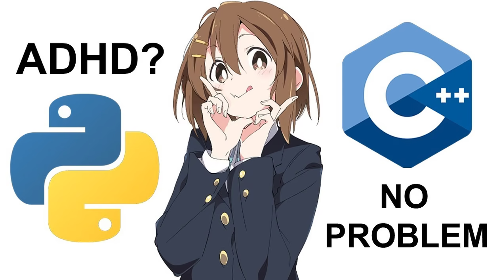

<!-- Hi There 波浪头图 -->

<!-- img -->

<!-- Tech Otaku Dynamic Typing ♡ -->

  

<!-- profile logo 个人资料徽标 -->

  
  
  
  
  
  
  

<!-- visitor statistics logo 访客数统计徽标 -->

  
  
  

<!-- GitHub 奖杯🏆，由 .github/workflows/PersonalStatus.yml 每天生成 -->

<!-- Snake Code Contribution Map 贪吃蛇代码贡献图 -->

<!-- Awesome repo 比较好的仓库-->
<h3 align="center">My Favorite Repositories </h3>

  
  

<h3 align="center">GitHub Stats</h3>

<!--  统计信息 -->
<!-- GitHub statistics -->

  
  

<!-- GitHub 活动统计图 -->
<!-- https://github.com/Ashutosh00710/github-readme-activity-graph -->

  

<h3 align="center">Now Playing</h3>

<!-- Spotify 音乐，左右是跟着节奏跳动的声波 -->

  

<h3 align="center">Tech Stack</h3>

<!-- programming tool icon 编程工具图标 -->

<!-- svg -->

  &nbsp;
  &nbsp;
  &nbsp;
  &nbsp;
  &nbsp;
  &nbsp;
  &nbsp;
  &nbsp;
  &nbsp;
  &nbsp;
  

<!-- gif -->

  
  
  
  
  
  
  
  

<!-- just img 图片-->

<!-- just img 图片 -->

