<!-- Hi There 波浪头图 -->

<!-- dynamic typing effect 动态打字效果 -->

  

<!-- img -->

<!-- profile logo 个人资料徽标 -->

  
  
  
  
  
  
  

<!-- visitor statistics logo 访客数统计徽标 -->

  
  
  

<!-- Awesome repo 比较好的仓库-->
<h3 align="center">My Favorite Repositories </h3>

<table>
  <tr>
    <td width="50%" valign="top" align="center">
      
       
      <a href="https://chaosnap.github.io/Typewriter-Nocturne/">Docs</a> · <a href="https://chaosnap.github.io/Typewriter-Nocturne/demo/">Live demo</a> · <a href="https://github.com/Chaosnap/Typewriter-Nocturne/releases">Download</a>
    </td>
    <td width="50%" valign="top" align="center">
      
       
      <a href="https://chaosnap.github.io/Yohaku/">Docs</a> · <a href="https://chaosnap.github.io/Yohaku/changelog/">Changelog</a> · <a href="https://github.com/Chaosnap/Yohaku/releases/latest">Download</a>
    </td>
  </tr>
</table>

<h3 align="center">GitHub Stats</h3>

<!--  统计信息 -->
<!-- GitHub statistics -->

  
  

<!-- GitHub 奖杯🏆，由 .github/workflows/PersonalStatus.yml 每天生成 -->

<!-- GitHub 活动统计图 -->
<!-- https://github.com/Ashutosh00710/github-readme-activity-graph -->

  

<!-- Snake Code Contribution Map 贪吃蛇代码贡献图 -->

<h3 align="center">Tech Stack</h3>

<!-- programming tool icon 编程工具图标 -->

<!-- svg -->

  &nbsp;
  &nbsp;
  &nbsp;
  &nbsp;
  &nbsp;
  &nbsp;
  &nbsp;
  &nbsp;
  &nbsp;
  &nbsp;
  

<!-- gif -->

  
  
  
  
  
  
  
  

<!-- just img 图片-->

<h3 align="center">Now Playing</h3>

<!-- Spotify 音乐，左右是跟着节奏跳动的声波 -->

  

<!-- just img 图片 -->

<!-- Joke 笑话 -->

<!--  skill badge 技能徽章 -->
<h3 align="center">Skills</h3>

<b>💪 正在学习</b>

  
  
  
  
  
  
  
  

<b>🧠 计划学习</b>

  
  
  
  
  
  
  
  

<b>🧰 常用的工具</b>

  
  
  
  
  
  
  
  

<!-- just img 图片 -->

